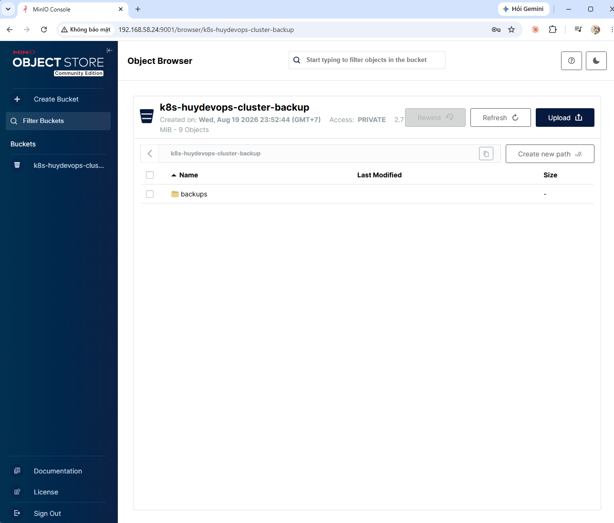
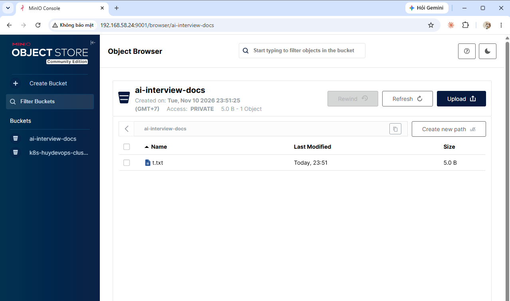
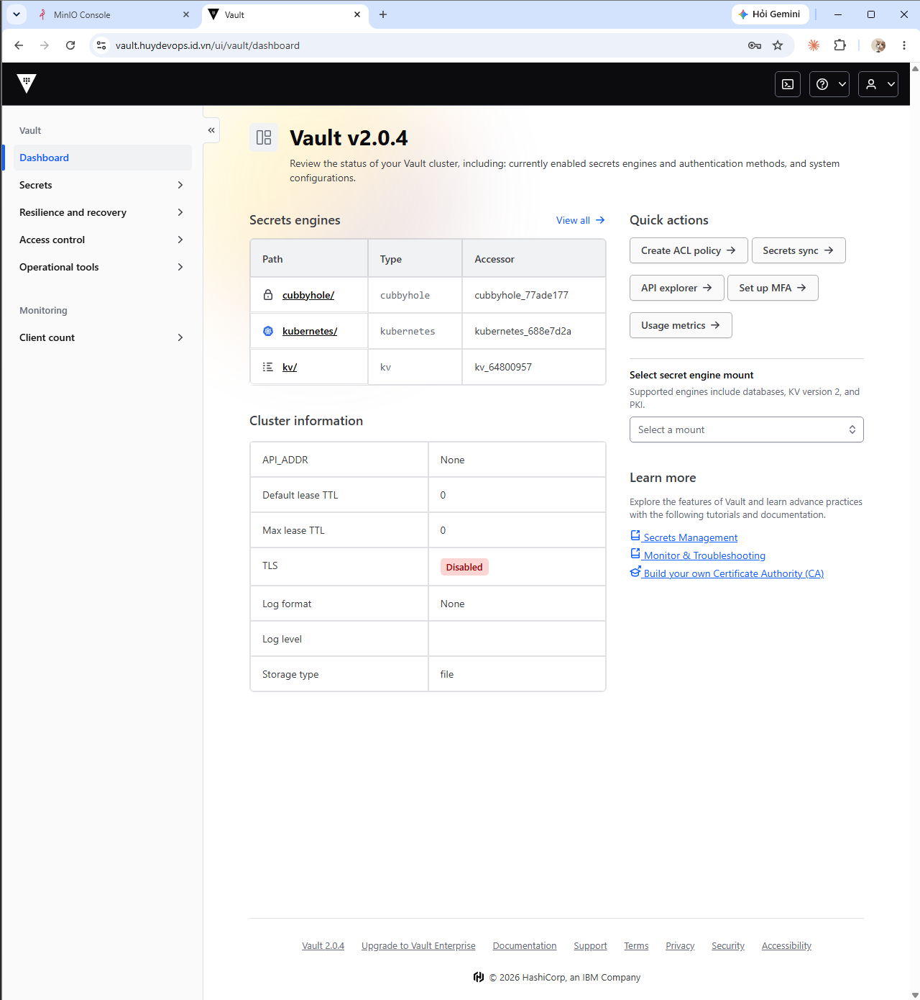
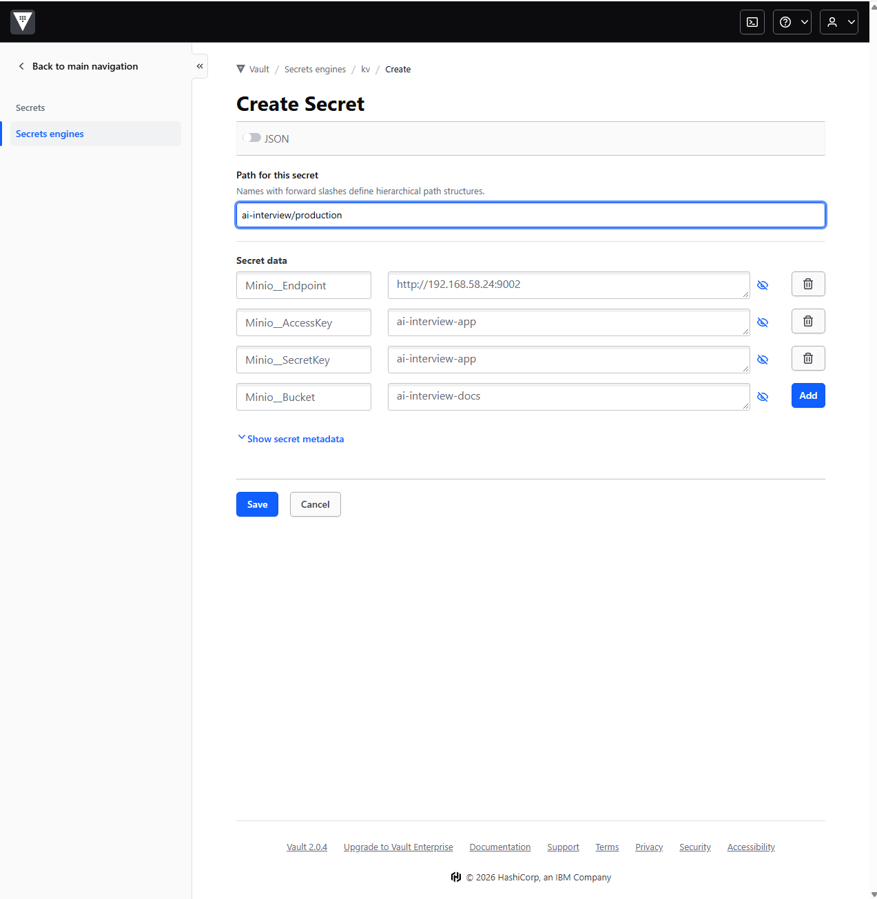
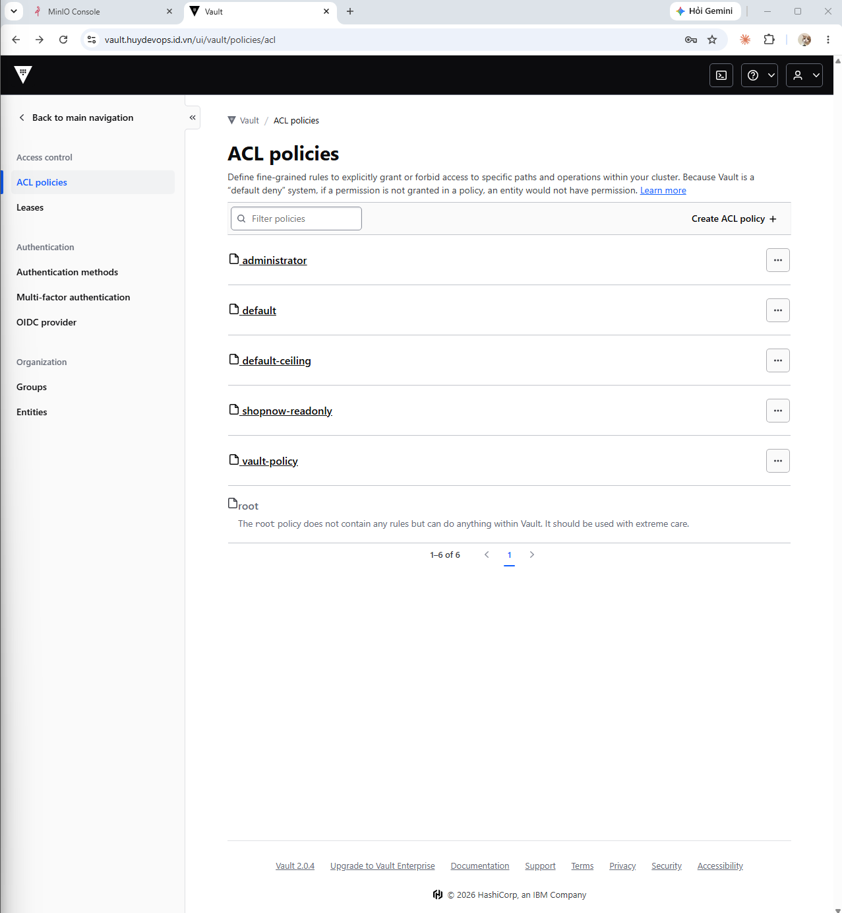
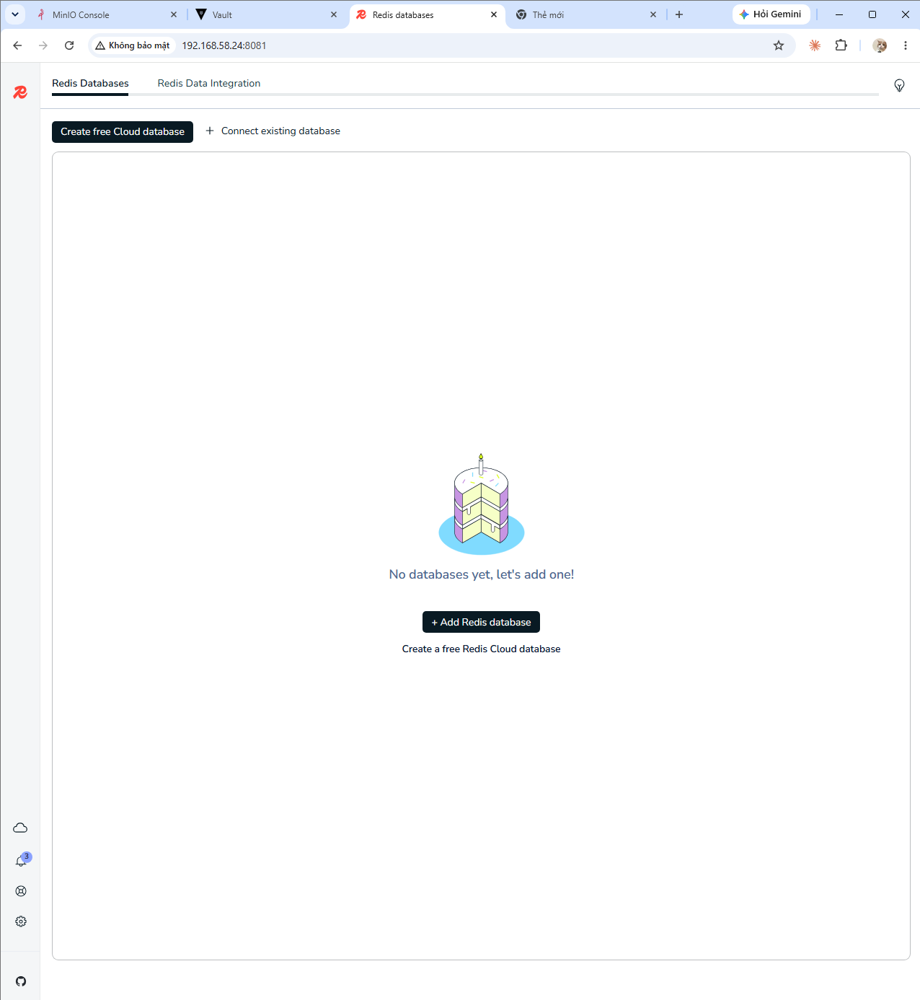
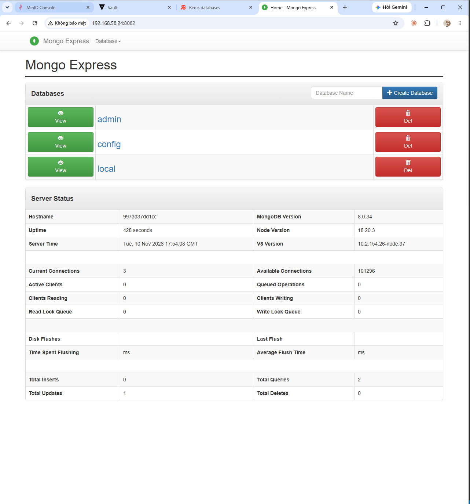

**QUY TRÌNH DEPLOY CHO ASSIGNMENT 3**

File Settings để hình dung biến môi trường 

```json
{
  "Infra": {
    "Mode": "Real",
    "Role": "All"
  },

  "Database": {
    "AutoMigrate": false
  },

  "ConnectionStrings": {
    "SqlServer": "Server=<mssql-host>,1433;Database=AiInterview;User Id=<login-rieng>;Password=<tu-Vault>;TrustServerCertificate=True"
  },

  "Mongo": {
    "ConnectionString": "mongodb://<user>:<password-tu-Vault>@192.168.58.24:27017/?authSource=admin",
    "Database": "aiinterview"
  },

  "Redis": {
    "ConnectionString": "<redis-host>:6379,password=<tu-Vault>"
  },

  "Qdrant": {
    "Host": "192.168.58.24",
    "Port": 6334,
    "UseHttps": false,
    "ApiKey": "",
    "Collection": "chunks"
  },

  "Minio": {
    "Endpoint": "http://192.168.58.24:9002",
    "AccessKey": "ai-interview-app",
    "SecretKey": "<tu-Vault>",
    "Bucket": "ai-interview-docs"
  },

  "Gemini": {
    "BaseUrl": "https://generativelanguage.googleapis.com/",
    "ApiKey": "<tu-Vault>",
    "Model": "<ten-model-sinh-van-ban>",
    "EmbeddingModel": "<ten-model-embedding>",
    "EmbeddingDimensions": 768
  },

  "Ingestion": {
    "MaxFileSizeMb": 50,
    "ChunkSize": 1000,
    "ChunkOverlap": 150,
    "MaxAttempts": 3,
    "RetryBaseDelayMs": 1000,
    "PollIntervalMs": 1000
  },

  "Interview": {
    "QuestionCount": 3,
    "MaxFollowUps": 2,
    "AnswerSeconds": 60
  }
}


```

Chuẩn bị setup hạ tầng trong máy ảo **192.168.58.24**

**MiniO**
MiniO hiện tại không hỗ trợ image nữa. 1 số image mà miniO không hỗ trợ nữa như là **FROM minio/minio:latest**

Cách xử lí

Clone source miniO từ github về để viết 1 Dockerfile mới để có thể custome được 1 image riêng của mình

Đầu tiên là clone repo minio về

```bash
git clone https://github.com/minio/minio.git
```

```bash
cd minio
```

Xem danh sách tag để build image
```bash
git tag --sort=-creatordate | head -5
```

rồi checkout qua tag đó
```bash
git checkout <tag-đã-chọn>
```

Kiểm tra phiên bản GoLang bởi vì MiniO sẽ build bằng GoLang
```bash
grep -E '^(go|toolchain) ' go.mod
```

tiến hành viết lại 1 file docker mới xài image của GoLang

```bash
cat > Dockerfile.local <<'EOF'
FROM golang:1.24.8-alpine AS build
RUN apk add --no-cache git bash make
WORKDIR /src
COPY . .
RUN CGO_ENABLED=0 go build -trimpath -ldflags "-s -w" -o /out/minio .

FROM alpine:3.20
RUN apk add --no-cache ca-certificates curl bash
COPY --from=build /out/minio /usr/bin/minio
COPY dockerscripts/docker-entrypoint.sh /usr/bin/docker-entrypoint.sh
RUN chmod +x /usr/bin/minio /usr/bin/docker-entrypoint.sh
EXPOSE 9000
VOLUME ["/data"]
ENTRYPOINT ["/usr/bin/docker-entrypoint.sh"]
CMD ["minio"]
EOF
```

Tiến hành build image đó lên
```bash
docker build -f Dockerfile.local -t minio-local:RELEASE.2025-10-15T17-29-55Z .
```

Run lên container rồi xóa liền
```bash
docker run --rm minio-local:RELEASE.2025-10-15T17-29-55Z minio --version
```

OUTPUT trả ra
```bash
quochuy2909@deploy-server:~/miniO/minio$ docker run --rm minio-local:RELEASE.2025-10-15T17-29-55Z minio --version
minio version DEVELOPMENT.GOGET (commit-id=DEVELOPMENT.GOGET)
Runtime: go1.24.8 linux/amd64
License: GNU AGPLv3 - https://www.gnu.org/licenses/agpl-3.0.html
Copyright: 2015-0000 MinIO, Inc.
```
-> Build thành công 

Vào bên trong file compose của miniO

```bash
cd ~/miniO
```

Sửa file compose
```bash
nano docker-compose.yaml
```

Đổi dòng **image:** của service của miniO thành
```yaml
image: minio-local:RELEASE.2025-10-15T17-29-55Z
```

Chạy file Compose lên

```bash
docker compose up -d
```

OUTPUT
```bash
quochuy2909@deploy-server:~/miniO$ docker compose up -d
WARN[0000] /home/quochuy2909/miniO/docker-compose.yaml: the attribute `version` is obsolete, it will be ignored, please remove it to avoid potential confusion
[+] Running 2/2
 ✔ Network minio_default  Created                                                                                         0.3s
 ✔ Container minio        Started         
```

Kiểm tra container
```bash
quochuy2909@deploy-server:~/miniO$ docker ps
CONTAINER ID   IMAGE                                        COMMAND                  CREATED              STATUS              PORTS                                                                                                                                       NAMES
8a995e243806   minio-local:RELEASE.2025-10-15T17-29-55Z     "/usr/bin/docker-ent…"   About a minute ago   Up About a minute   0.0.0.0:9001->9001/tcp, [::]:9001->9001/tcp, 0.0.0.0:9002->9000/tcp, [::]:9002->9000/tcp                                                    minio
```

Kiểm tra kết nối đến với MiniO
```bash
quochuy2909@deploy-server:~/miniO$ curl -s -o /dev/null -w "%{http_code}\n" http://localhost:9002/minio/health/live
```

Kì vọng phải ra **200**

Nhập trên trình duyệt để test
```
http://192.168.58.24:9001
```

Nhập username: admin
Nhập password: 12345678

Phải thấy giao diện ra như hình


Việc dùng tài khoản mật khẩu cho MiniO hiện tại đang hơi rủi ro xét về mặt thiết kế nên là cần phải làm lại như là thêm **access key** và **secret key**

Bây giờ cần tạo trước 1 bucket riêng cho app

1. Nhìn trên màn hình bên trái **Create Bucket** menu trái của app
2. Đặt tên **ai-interview-docs** bấm **Create**

Bởi vì giao diện web UI của MiniO không có tạo key trên đó nên là phải có tools để làm dưới cmd

Các câu lệnh cần chạy
```bash
cd ~/miniO
```

Tải miniO client từ trang chính thức của miniO
```bash
curl -fLO https://dl.min.io/client/mc/release/linux-amd64/mc
```

MiniO gỡ trang rồi nên là kéo mã nguồn về chạy công cụ lên
```bash
docker run --rm -e U="$(id -u)" -e G="$(id -g)" -v "$PWD":/out golang:1.24-alpine sh -c 'apk add --no-cache git && git clone --depth 1 https://github.com/minio/mc /src && cd /src && CGO_ENABLED=0 go build -o /out/mc . && chown "$U:$G" /out/mc'
```

Kiểm tra bản đã cài
```bash
quochuy2909@deploy-server:~/miniO$ ls -l mc
-rwxr-xr-x 1 quochuy2909 quochuy2909 44187146 Nov 10 16:27 mc
```

Cấp quyền cho tools
```bash
chmod +x mc
```

Kiểm tra phiên bản công cụ
```bash
quochuy2909@deploy-server:~/miniO$ ./mc --version
mc version DEVELOPMENT.GOGET (commit-id=DEVELOPMENT.GOGET)
Runtime: go1.24.13 linux/amd64
Copyright (c) 2015-0000 MinIO, Inc.
License GNU AGPLv3 <https://www.gnu.org/licenses/agpl-3.0.html>
```

Sau khi có công cụ rồi thì bắt đầu setup key

Đăng nhập mc tools bằng admin
```bash
./mc alias set local http://localhost:9002 admin '12345678'
```

OUTPUT kiểm chứng
```bash
quochuy2909@deploy-server:~/miniO$ ./mc alias set local http://localhost:9002 admin '12345678'
Added `local` successfully
```


Tạo file quy định trên bucket của app
```bash
cat > ai-policy.json <<'EOF'
{
  "Version": "2012-10-17",
  "Statement": [
    { "Effect": "Allow",
      "Action": ["s3:ListBucket", "s3:GetBucketLocation"],
      "Resource": ["arn:aws:s3:::ai-interview-docs"] },
    { "Effect": "Allow",
      "Action": ["s3:GetObject", "s3:PutObject", "s3:DeleteObject"],
      "Resource": ["arn:aws:s3:::ai-interview-docs/*"] }
  ]
}
EOF
```

**Ý nghĩa**:
```json
"Effect": "Allow",
"Action": ["s3:ListBucket", "s3:GetBucketLocation"],
"Resource": ["arn:aws:s3:::ai-interview-docs"]
```

+ Cho phép liệt kê danh sách file trong bucket và lấy thông tin vị trí của bucket

+ Resource là chính bucket ai-interview-docs (không có /*).


```json
"Effect": "Allow",
"Action": ["s3:GetObject", "s3:PutObject", "s3:DeleteObject"],
"Resource": ["arn:aws:s3:::ai-interview-docs/*"]
```

+ Cho phép tải xuống (Get), tải lên (Put) và xóa (Delete) file.

+ /* nghĩa là áp dụng cho mọi file bên trong bucket.

**Note giải thích về aws s3**: 
+ Bởi vì S3 là dịch vụ lưu trữ file của amazon. Cách vận hành của nó đã là chuản chung của ngành. MiniO là công cụ tự host mã nguồn mở cũng tuân theo quy tắc đó. Nếu đặt sai thì không chạy được. 

+ Cú pháp bắt chước S3 làm cho người dùng thấy là giống như đang xài S3 nhưng thực tế là đang xài MiniO

Mổ xẻ thành phần câu lệnh AWS 
```
arn:aws:s3:::ai-interview-docs
 │   │   │  │  └── tên bucket của bạn
 │   │   │  └───── (để trống: vùng, S3 không cần)
 │   │   └──────── dịch vụ: s3
 │   └──────────── nhà cung cấp: aws
 └──────────────── "Amazon Resource Name"

```

Ví dụ với ec2:

```
arn:aws:ec2:ap-southeast-1:123456789012:instance/i-0abc123
```

Bắt đầu tạo ra **policy**

```bash
quochuy2909@deploy-server:~/miniO$ ./mc admin policy create local ai-interview-policy ai-policy.json
Created policy `ai-interview-policy` successfully.
```

Bắt đầu tạo ra user **(access key)** và password **(secret key)** mới

```bash
./mc admin user add local ai-interview-app '<secret-mạnh>'
```

OUTPUT

```bash
quochuy2909@deploy-server:~/miniO$ ./mc admin user add local ai-interview-app 'ai-interview-app'
Added user `ai-interview-app` successfully
```

Nạp file **policy** tương ứng vào bên trong user mới

```bash
quochuy2909@deploy-server:~/miniO$ ./mc admin policy attach local ai-interview-policy --user ai-interview-app
Attached Policies: [ai-interview-policy]
To User: ai-interview-app
```

Kiểm tra đăng nhập bằng user mới
```bash
quochuy2909@deploy-server:~/miniO$ ./mc alias set appkey http://localhost:9002 ai-interview-app 'ai-interview-app'
Added `appkey` successfully.
```

Ghi file thử vào trong bucket **ai-interview-docs** với user **ai-interview-app**

```bash
quochuy2909@deploy-server:~/miniO$ echo test > t.txt && ./mc cp t.txt appkey/ai-interview-docs/t.txt
```

Ghi thử vào bucket huy-k8s và bị từ chối vì trong file quyền json chỉ quy định là làm được trên bucket **ai-interview-docs**
```bash
quochuy2909@deploy-server:~/miniO$ ./mc ls appkey/k8s-huydevops-cluster-backup
mc: <ERROR> Unable to list folder. Access Denied.
```

Output kiểm chứng trên UI


Dọn dẹp file test
```bash
quochuy2909@deploy-server:~/miniO$ ./mc rm appkey/ai-interview-docs/t.txt && rm t.txt ai-policy.json
Removed `appkey/ai-interview-docs/t.txt`.
```

Đăng nhập vào trong vault để áp các secret value vào

Sau khi đăng nhập bằng cách dán 3 cái tokens vào thì sẽ ra giao diện giống vậy



Vào trong phần kv tạo riêng folder cho secret của mình trong vault. Đường dẫn secrets của vault **kv/ai-interview/production**

Tạo secrets kv mới dành cho production
Sau khi tạo


Sau đó tạo thêm policy cho acl policies 


Vào trong **Create ACL Policy** -> đặt tên **ai-interview-policy** dán khối 

```bash
path "kv/data/ai-interview/*" {
  capabilities = ["read"]
}
path "kv/metadata/ai-interview/*" {
  capabilities = ["read", "list"]
}
```

Gắn policy vào trong eso
1. Menu trái chọn Authentication methods → kubernetes.
2. Tab Roles → bấm role eso → Edit role.
3. Ở ô Generated Token’s Policies (hoặc Token policies), giữ vault-policy và thêm **ai-interview-policy**
4. Bấm Save.

Kiểm tra eso đã nhận được quyền chưa
Vào trong máy **kubernetes1**
```bash
kubectl -n vault exec -it vault-0 -- sh
```
Login vào vault
```bash
vault login -method=userpass username=huycq
```

Đọc policies trong đó
```bash
/ $ vault read auth/kubernetes/role/eso
Key                                         Value
---                                         -----
alias_metadata                              map[]
alias_name_source                           serviceaccount_uid
bound_service_account_names                 [external-secrets]
bound_service_account_namespace_selector    n/a
bound_service_account_namespaces            [external-secrets]
token_bound_cidrs                           []
token_explicit_max_ttl                      0s
token_max_ttl                               0s
token_no_default_policy                     false
token_num_uses                              0
token_period                                0s
token_policies                              [vault-policy ai-interview-policy]
token_ttl                                   0s
token_type                                  default
```

Restart lại eso chạy trong cụm k8s để áp dụng liền cấu hình token_policies

Kiểm tra namespace của eso
```bash
kubectl get deploy -A | grep -i external-secrets
```

Sau đấy restart lại eso để áp dụng cấu hình policies mới
```bash
kubectl -n <namespace-của-eso> rollout restart deploy/external-secrets
```

**TIẾP TỤC CHẠY LẠI CÁC HẠ TẦNG KHÁC**
Chạy lại hạ tầng của mongo
```bash
docker compose -f docker-compose.infra.yml up -d mongo-db
```

Chạy lại hạ tầng của mongo-ui
```bash
docker compose -f docker-compose.infra.yml up -d mongo-express
```


Kiểm tra hạ tầng docker của mongo

Chạy lại hạ tầng của redis
```bash
docker compose -f docker-compose.infra.yml up -d redis
```

Chạy lại hạ tầng của redis-ui
```bash
docker compose -f docker-compose.infra.yml up -d redis-ui
```

Test hạ tầng Redis
```bash
quochuy2909@deploy-server:~/logistic-fulfillment-system$ nc -zv 192.168.58.24 6379
Connection to 192.168.58.24 6379 port [tcp/*] succeeded!
```

Test hạ tầng Mongo
```bash
quochuy2909@deploy-server:~/logistic-fulfillment-system$ nc -zv 192.168.58.24 27017
Connection to 192.168.58.24 27017 port [tcp/*] succeeded!
```

Truy cập trình duyệt của redis và mongo
Redis
```
http://192.168.58.24:8081
```


Mongo
```
http://192.168.58.24:8082
```


Kiểm tra hạ tầng của Qdrant
```bash
quochuy2909@deploy-server:~/logistic-fulfillment-system$ docker ps | grep "qdrant"
98ad883b004b   qdrant/qdrant:latest                         "./entrypoint.sh"        2 months ago     Up 3 hours      0.0.0.0:6333-6334->6333-6334/tcp, [::]:6333-6334->6333-6334/tcp                                                                             qdrant_huydevops
```

Cập nhật lại hết các biến secret trong vault


Sau khi cập nhật hết secret rồi tiến hành thêm chart vào dự án để đưa hạ tầng lên cụm k8s rồi sau đó thêm jenkins sau
**Note**: Chart sau khi thêm sẽ chạy bằng helm thủ công rồi mới đưa lên jenkins kết hợp argo cd sau 

+ Cập nhật docker file và thống nhất docker image trước trong source code 
**Tên Image:**
```
harbor.huydevops.id.vn/ai-interview/app:0.1.0
```

+ Cập nhật lại file values.yaml bên trong source code

Tạo namespace bên trong k8s-1

```bash
kubectl create namespace ai-interview
```

Tạo secret pull image trong harbor

```bash
kubectl -n ai-interview create secret docker-registry harbor-pull --docker-server=harbor.huydevops.id.vn --docker-username='huycq' --docker-password='<password>'
```

Kiểm tra lại pull secret
```bash
kubectl -n ai-interview get secret harbor-pull
```

Sửa lại file values.yaml

```yaml
imagePullSecrets:
  - name: harbor-pull
```

Clone Source về máy có docker và build docker image lên

```bash
git clone https://github.com/QuochuyChung/PRN222-Assignment-3.git
```

```bash
docker build -t harbor.huydevops.id.vn/ai-interview/app:0.1.0 .
```

Push lên registry harbor

Trước đó phải tạp project trong harbor

1. Mở giao diện Harbor (https://harbor.huydevops.id.vn), đăng nhập.
2. Vào Projects → New Project.
3. Project Name: ai-interview (đúng chính tả, chữ thường).
4. Access Level: chọn Private nếu muốn dùng pull secret như đã chuẩn bị, hoặc Public nếu muốn khỏi cần secret.
5. Bấm OK.

```bash
docker push harbor.huydevops.id.vn/ai-interview/app:0.1.0
```

**Tag**: 0.1.0
**Image Name**: harbor.huydevops.id.vn/ai-interview/app

Lưu ý phần chart nên tạo ra 1 file values ở dưới trước khi chạy helm để đè lên file values cũ

Trước tiên ngay tại máy có docker thì cài thêm helm để đóng gói app đó lại rồi đưa lên registry
hoặc là clone source về máy kubernetes để xài luôn

Cài helm

```bash
curl -fsSL https://raw.githubusercontent.com/helm/helm/main/scripts/get-helm-3 | DESIRED_VERSION=v3.16.4 bash
```

Kiểm tra version
```bash
helm version --short
```


Kiểm tra chart
```bash
quochuy2909@deploy-server:~/asg3-prn222/PRN222-Assignment-3$ helm lint helm/ai-interview
==> Linting helm/ai-interview
[INFO] Chart.yaml: icon is recommended

1 chart(s) linted, 0 chart(s) failed
```

Đóng gói chart thành **.tgz**
```bash
helm package helm/ai-interview --version 0.1.0 --app-version 0.1.0
```

Đăng nhập vào bên trong Harbor
```bash
helm registry login harbor.huydevops.id.vn
```

Push chart lên registry
```bash
helm push ai-interview-0.1.0.tgz oci://harbor.huydevops.id.vn/ai-interview
```

Kiểm tra chart đã nằm trên Harbor chưa
```bash
quochuy2909@deploy-server:~/asg3-prn222/PRN222-Assignment-3$ helm show chart oci://harbor.huydevops.id.vn/ai-interview/ai-interview --version 0.1.0
Pulled: harbor.huydevops.id.vn/ai-interview/ai-interview:0.1.0
Digest: sha256:adabcf18bf3c63fb7548ac3b934cf3f7f12ed7a8c491a4f366912ed299ded5bf
apiVersion: v2
appVersion: 0.1.0
description: AI Interview (vấn đáp bằng giọng nói) - hai Deployment web và worker
  dùng chung một image
name: ai-interview
type: application
version: 0.1.0
```

Sau khi push chart xong bắt đầu qua con máy k8s

Kiểm tra phiên bản của Eso để điền đúng apiVersion trong chart

```bash
kubectl get crd externalsecrets.external-secrets.io -o jsonpath='{.spec.versions[*].name}'
```

Nếu kết quả có v1 (và không có v1beta1), thêm dòng apiVersion: external-secrets.io/v1 vào file values ở bước 2.


Tạo file values-prod.yaml riêng để ghi đè vào chart

```bash
vi values-prod.yaml
```


```yaml
image:
  tag: "0.1.0"

imagePullSecrets:
  - name: harbor-pull

ingress:
  host: ai-interview.huydevops.id.vn

externalSecret:
  apiVersion: external-secrets.io/v1
```

Lưu lại rồi sau đó chạy chart kèm theo file yaml mới ghi đè lúc nãy
```bash
helm upgrade --install ai-interview oci://harbor.huydevops.id.vn/ai-interview/ai-interview --version 0.1.0 -n ai-interview -f values-prod.yaml
```

OUTPUT:
```bash
quochuy@kubernetes1:~/asg3-prn222-chart$ helm upgrade --install ai-interview oci://harbor.huydevops.id.vn/ai-interview/ai-interview --version 0.1.0 -n ai-interview -f values-prod.yaml
Release "ai-interview" does not exist. Installing it now.
Pulled: harbor.huydevops.id.vn/ai-interview/ai-interview:0.1.0
Digest: sha256:adabcf18bf3c63fb7548ac3b934cf3f7f12ed7a8c491a4f366912ed299ded5bf
NAME: ai-interview
LAST DEPLOYED: Tue Nov 10 19:26:25 2026
NAMESPACE: ai-interview
STATUS: deployed
REVISION: 1
DESCRIPTION: Install complete
TEST SUITE: None
```

Kiểm tra ESO và secret từ vault
```bash
quochuy@kubernetes1:~/asg3-prn222-chart$ kubectl -n ai-interview get externalsecret
NAME                   STORETYPE            STORE   REFRESH INTERVAL   STATUS         READY   LAST SYNC
ai-interview-secrets   ClusterSecretStore   vault   1h                 SecretSynced   True    49s
```

Cột STATUS phải là SecretSynced và READY là True.

ExternalSecret SecretSynced, READY True: ESO đã lấy được secret từ Vault và tạo Secret trong cluster.

Kiểm tra hạ tầng
```bash
quochuy@kubernetes1:~/asg3-prn222-chart$ kubectl -n ai-interview get pods
NAME                                   READY   STATUS    RESTARTS   AGE
ai-interview-web-7955bf665c-rdps4      1/1     Running   0          108s
ai-interview-worker-68c4bcd6bc-2fmp7   1/1     Running   0          108s
```

Kiểm tra kết nối healthy
1 cửa sổ
```bash
quochuy@kubernetes1:~/asg3-prn222-chart$ kubectl -n ai-interview port-forward svc/ai-interview-web 8080:80
Forwarding from 127.0.0.1:8080 -> 8080
Forwarding from [::1]:8080 -> 8080
Handling connection for 8080
```

1 cửa sổ khác mở song song và chạy
```bash
quochuy@kubernetes1:~$ curl -s http://localhost:8080/health/ready
Healthy
```